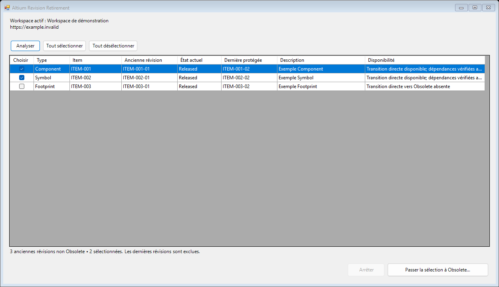

# Altium Revision Retirement

Standalone C# extension loaded directly into Altium Designer. It finds superseded **component, schematic symbol and PCB footprint revisions** in the active workspace, lets you select them individually or together, and requests their existing lifecycle transition to **Obsolete**.

No bridge, companion application, local web server or separately stored Altium credentials. The full interface, validation messages and confirmation dialog are in English. [English user guide](docs/USER_GUIDE.md) · [Documentation française](README.fr.md).

**Version 0.1.3 — preview.** Native compilation, installation and opening the branded window were verified with Altium Designer 26.11.1.28 / C# SDK 4.0 / .NET Framework 4.8. The Fluidra logo, English header and English guide link were visible in the running Designer process. Safety tests use an isolated fake gateway. Real workspace enumeration and lifecycle transitions still require the [sandbox acceptance procedure](docs/VALIDATION.md); no production lifecycle transition was performed by the installer or these checks. This is an independent extension, not an Altium-certified product.

## Build and install

Requirements: Windows x64, Altium Designer with the licensed **Altium Developer** extension / SDK 4.0 installed, and .NET Framework 4.8.

```powershell
.\scripts\test.ps1
.\scripts\build.ps1
```

The build detects the newest installed Designer SDK through the Windows registry. You can supply `-AltiumSdkRoot 'C:\...\SDK4.0'` to target another installation. Build output stays inside `bin\Release`; it does not install anything or change Altium's registry.

1. In Altium Designer, open the generated **`AltiumRevisionRetirement.local.EPD`**. The tracked EPD is a template; build first to resolve all paths.
2. Use **Install Extension** / **Update Local Installation** in Altium Developer, then close Designer normally.
3. Run `scripts/build.ps1` again, then **`scripts/install.ps1`**. The installer copies and verifies runtime files in the registered extension folder, backs up the local registry and fills only this extension's English description, guide link and Fluidra thumbnails. Other extension registrations are checked for changes.
4. Restart Designer. Use **DXP → Revision Retirement…**, or **Tools → Revision Retirement…** in a schematic/PCB editor. The fallback is **Run Process** with **`AltiumRevisionRetirement:Manage`**.

The build keeps output in `bin\Release` even if Altium Developer rewrites the project output path. The install script requires Designer to be closed and never closes user documents itself. See the [English user guide](docs/USER_GUIDE.md) for the full installation, control translations, operating workflow, troubleshooting, updates and removal.

SDK assemblies are resolved from your licensed local installation during the build. Neither those assemblies nor your SDK ticket are committed or included in the source ZIP. See [Altium's Developer installation workflow](https://www.altium.com/documentation/altium-dxp-developer).



The inventory starts at the workspace's **Components** root and loads its complete recursive folder tree before reading items. Older `Draft` revisions are included; selection depends on permissions and the existing direct transition to Obsolete, without requiring a release date.

## Use

1. Connect to the intended workspace in Designer.
2. Choose **Scan**. This reads the workspace and displays only revisions other than the native latest revision whose current state is not named `Obsolete`. Insufficient permissions and missing/ambiguous direct transitions remain visible with a blocking reason.
3. Select individual rows or **Select all** (all rows with a valid direct transition). The latest revision of every item is excluded even if hidden, planned or already Obsolete.
4. Choose **Set selected revisions to Obsolete…**. The extension rereads the selected items and dependencies. A referenced symbol/footprint cannot be retired while a parent revision remains non-Obsolete. Select an eligible old parent revision as well, or leave the model unchanged. A latest parent is never added automatically.
5. Review the ordered plan, enter a mandatory lifecycle change note, and confirm. Parents are processed before their selected models. There is no cascade or automatic multi-step lifecycle route.
6. Review the result and rescan. **Stop** stops between operations; it does not undo successful transitions.

A flushed CSV journal is written to `%LOCALAPPDATA%\AltiumRevisionRetirement\Audit`. Each attempted change has an `intent` entry before the SDK write and a `verified` entry after a fresh read. If a response is lost, the batch stops without retrying. Check the revision's native Altium timeline before any manual retry.

## Protection and scope

- Workspace and user identity are captured at scan time and checked again during preparation and execution. The extension uses the connected DXP server's enterprise vault, without falling back to another configured vault.
- The latest revision comes from **`GetLastItemRevision`**, by GUID; revision labels are never sorted to decide which is latest. All/hidden revisions are requested. Deleted items are excluded.
- Every item history, current state, permission flag and direct transition is reread before a write. The native adapter checks again after the journal flush. Missing, ambiguous or inconsistent data stops the operation.
- Only one **`AddLifeCycleStateChanges`** event is submitted at a time. No item deletion, release, payload update, lifecycle-definition edit, role escalation or direct database access is implemented. The server can reject a request under its configured permissions and lifecycle rules.
- Referencing parent revisions reported by the native revision-link API are checked. Unknown, inaccessible, foreign-workspace or non-Obsolete unselected parents block the operation.
- After each accepted event, the target state is reread and the states of all other revisions in the before-snapshot, including the latest, are checked for changes. Failure stops the remaining batch.

The public SDK does not expose an atomic “transition only if still non-latest” compare-and-swap in the interface used here. Rechecks reduce the concurrency window but cannot prove safety against a simultaneous external revision deletion, restore, dependency change or lifecycle edit between the final read and server write. Coordinate those operations during execution. A batch is not a transaction and has no automatic rollback. Visibility and dependency coverage are limited to the current user's native API access. Existing projects that use old revisions keep their revision links, but can report those revisions as non-applicable after obsolescence.

See [safety design and limitations](docs/SAFETY.md), [validation checklist](docs/VALIDATION.md), and Altium's [revision lifecycle documentation](https://www.altium.com/documentation/altium-designer/connected-workspace/items/managing-revision-lifecycle).

## Development

```powershell
.\scripts\test.ps1      # safety engine, no Altium login or SDK needed
.\scripts\build.ps1     # full native extension, licensed local SDK required
.\scripts\install.ps1   # stage runtime + display metadata after native EPD registration, Designer closed
.\scripts\package.ps1   # tested source ZIP + SHA-256, SDK files excluded
```

GitHub Actions runs the safety, folder-inventory and English-interface tests on Windows. It does not compile the licensed native adapter or exercise a connected workspace. `src/AltiumGateway.cs` owns all SDK access; `src/RetirementEngine.cs` owns eligibility, dependency order and latest-revision guards. `src/RetirementForm.cs` owns selection and the confirmation dialog.
