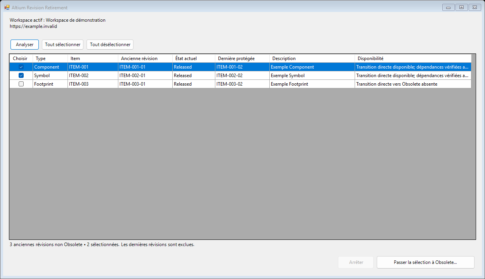
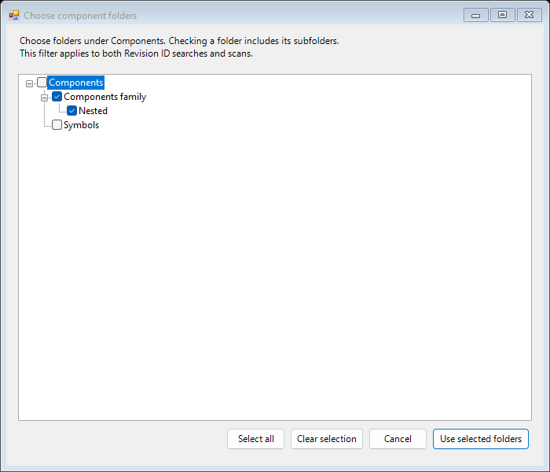

# Altium Revision Retirement — User Guide

Review older workspace revisions and move selected ones to **Obsolete**, while keeping the latest revision of every item protected.

The extension runs directly inside Altium Designer. It uses the active Altium 365 workspace and the permissions of the signed-in user. It covers components, schematic symbols and PCB footprints. The Fluidra header explains this scope when the window opens; no analysis or lifecycle change starts automatically.

## Installation

Requirements: Windows x64, .NET Framework 4.8 and a licensed Altium Designer installation. The two Altium runtime DLLs are included in the compiled package. Altium Developer, an SDK, compiler, IDE and SDK ticket are not needed on the target PC.

1. Download **`altium-revision-retirement-0.1.7-windows-x64.zip`** from [this repository's latest GitHub release](https://github.com/BenoitGaltier/altium-revision-retirement/releases/latest) and extract the complete ZIP. No GitHub account or repository invitation is required to download it. Choose the compiled Windows asset; the automatic Source code archives are for development. Version 0.1.7 is the latest release; native acceptance of its new workflow remains pending.
2. Close Altium Designer normally and handle your own unsaved documents.
3. In 64-bit PowerShell, from the extracted package folder, run:

   ```powershell
   .\Install.ps1
   ```

4. The installer checks the complete payload, including the bundled runtime libraries, copies it and creates or updates this extension's native local registration. Other extension entries are preserved. If a packaged file is missing or corrupted, download and extract the complete release again. If access is denied, rerun PowerShell as administrator.
5. Restart Altium Designer. In **Extensions and Updates → Installed**, find **Altium Revision Retirement** and check its description and Fluidra logo.
6. Open **Revision Retirement…** from the Tools menu in a schematic/PCB editor. If a customized menu hides the entry, run **`AltiumRevisionRetirement:Manage`** through **Run Process**.

The runtime files are stored in `Extensions\AltiumRevisionRetirement` inside the selected Altium installation. The release includes the two Altium runtime DLLs and vendor notices; SDK sources, license files and tickets are excluded. `Install.ps1 -CheckOnly` verifies prerequisites and package integrity without writing anything. See the [installation instructions](INSTALLATION.md) for downloaded-script warnings and target paths.

## Window and controls

All extension controls, status messages, validation errors and confirmation text are in English. Item names, revision identifiers and lifecycle names remain exactly as defined in the workspace.

The main window is modeless: it can stay open while you use Designer. Running the menu command again activates the existing window, including its list and selection. The transition confirmation remains a dialog requiring your decision. SDK operations still run on Designer's UI thread, so an individual network call can take time.

| Control | Meaning |
| --- | --- |
| **Revision ID** | Exact native revision identifier, for example `CMP-001-03`. A populated field takes precedence over scanning. |
| **Search** | Find that revision's item and list all its older non-Obsolete revisions, even when the entered ID is the latest. No full scan or fallback scan runs. |
| **Scan** | Appears when Revision ID is empty. Read items under the selected Components folders. |
| **Folders…** | Choose one or more folders in the complete Components tree. A checked folder includes descendants; uncheck a child to exclude that branch. The filter also applies to Revision ID lookup. |
| **Refresh list** | Reread only displayed items and update their rows. Completed and blocked rows remain visible. No full scan runs. |
| **Select** | Select one old revision. |
| **Select all** | Select all listed revisions with a valid direct transition. |
| **Clear selection** | Clear the selection. |
| **Old revision** | The superseded revision that may be changed. |
| **Current state** | Its current lifecycle state. |
| **Protected latest** | The latest revision, which is excluded from the operation. |
| **Availability** | Eligibility or the reason a row is blocked. |
| **Set selected revisions to Obsolete…** | Validate the selection and review the proposed transitions. |
| **Stop** | Stop between operations. Completed transitions remain applied. |
| **User guide (English)** | Open this guide. |





## Review and retire revisions

1. Connect to the intended workspace in Designer. Open the extension and check the workspace name and URL.
2. Optionally click **Folders…**, choose branches under **Components** and confirm the filter. For one item, enter an exact **Revision ID** and click **Search** (or press Enter). All its older non-Obsolete revisions are returned; the latest is protected even when its ID was used to find the item. A missing ID or an item outside the selected folders returns no rows and never starts a global scan. To inventory folders instead, clear the ID and click **Scan**. The scan discovers the complete folder tree under Components, then inventories only selected branches. Both modes include older `Draft` revisions. Reading all item histories can take several minutes. The scan's final status retains the number of folders, active items and revisions read, and deleted items excluded. Single-revision items and the latest revision of every item are excluded. Hidden latest revisions are also protected.
3. Review the item, revision, current state and protected latest revision. A blocked row stays visible so you can see why it cannot be changed. Typical reasons include missing write permissions, an absent or ambiguous Obsolete state, or no direct lifecycle transition.
4. Select the revisions to retire. **Select all** selects eligible rows; it does not bypass the dependency checks.
5. Click **Set selected revisions to Obsolete…**. The extension rereads the items and their parent references. If a symbol or footprint is still referenced by a non-Obsolete parent, the operation stops unless that old parent is also explicitly selected and eligible. A latest parent is never added to the selection.
6. Review the ordered plan. Selected parents appear before their models. Enter a short note explaining the change, then click **Confirm**. Closing or cancelling this dialog applies no transition.
7. Continue from the same list. Successfully verified revisions now show **Obsolete**, are unchecked and cannot be selected again. Unattempted rows and their selections remain. Cancelling the confirmation or a failed validation also retains the list. Use **Refresh list** for a targeted reread without scanning again. A fresh successful Search or Scan replaces the list; a failed or stopped read preserves the previous results and their displayed scope.

For example, if component revision `COMP-001-02` is the latest and still uses `SYM-001-01`, that symbol revision is protected by the parent reference. The extension does not retire the latest component or replace its symbol automatically. If an eligible old component revision is the only non-Obsolete parent of an old symbol, explicitly selecting both allows the component to be processed first.

## Journal and interrupted operations

The local CSV journal is stored at:

```text
%LOCALAPPDATA%\AltiumRevisionRetirement\Audit
```

An **intent** event is flushed to disk before each native transition. A **verified** event is written after a fresh read confirms the target state and the unchanged states of the other revisions. The note is also submitted to Altium with the lifecycle event.

The batch stops on the first rejected or uncertain operation. It does not retry automatically and does not undo successful changes. If an intent has no verified event, check the revision's native Altium timeline before deciding whether to retry. A lost response can occur after the server has already accepted a change.

An uncertain row stays visible, unchecked and blocked. Review its native timeline, then use **Refresh list** to read its current state. Already Obsolete or newly latest revisions remain blocked. Every subsequent Apply repeats the existing workspace, latest-revision, permission and dependency checks; retaining a row never authorizes a stale write.

## Troubleshooting

| Symptom | Action |
| --- | --- |
| Extension is installed but no menu appears | Restart Designer, check the installed extension, then use Run Process with `AltiumRevisionRetirement:Manage`. |
| Window opens but the scan cannot connect | Sign in to the intended workspace in Designer and rescan. The extension does not fall back to a different workspace. |
| Workspace or user changed after the scan | Run a new scan. The previous selection is deliberately rejected. |
| No direct transition to Obsolete | Ask the lifecycle owner to review the definition. The extension does not create transitions or follow an automatic multi-step route. |
| Model is used by a non-Obsolete parent | Keep the model, or explicitly select an eligible old parent too. A latest parent remains protected. |
| Inventory is incomplete or inconsistent | Stop and rescan. The extension refuses truncated or inconsistent results. |
| Installer says Altium is still running | Close Designer normally before updating; do not force-terminate it. |
| Installer says this is a source download | Download the compiled `windows-x64.zip` release asset and run its `Install.ps1`. |
| Missing or corrupt bundled Altium runtime library | Download and extract the complete Windows release again. Altium Developer is not required. |
| Description or logo is missing from Installed extensions | Close Designer, rerun `Install.ps1` from the compiled package, and restart. |

A local scan status report is available at `%LOCALAPPDATA%\AltiumRevisionRetirement\Diagnostics\last-scan.txt`. It records whether a scan is running, succeeded, failed or was cancelled, with its progress and any error details. It does not change workspace data and is not included in Git.

## Updates and removal

For an update, download and extract the new compiled Windows release, close Designer, run `Install.ps1`, then restart. Backups and hash receipts are kept under `%LOCALAPPDATA%\AltiumRevisionRetirement\InstallationBackups`; these machine-specific files are excluded from Git.

Remove the extension through **Extensions and Updates → Installed**, then restart Designer. Removing the extension does not reverse lifecycle transitions already accepted by the workspace.

## Validation and limits

Installation and opening the window are separate from validating lifecycle writes. Use the [sandbox acceptance procedure](VALIDATION.md) before a production batch. The [safety design](SAFETY.md) explains identity checks, native API calls, dependency checks and audit behavior.

The SDK interface used here does not expose an atomic operation combining “still an old revision” with the transition. Do not delete/restore affected revisions, change their lifecycle definitions or edit their dependencies concurrently with a batch. Visibility is limited to what the signed-in user and the native API can access. Existing projects keep their old revision links, but can show applicability warnings after those revisions become Obsolete.
